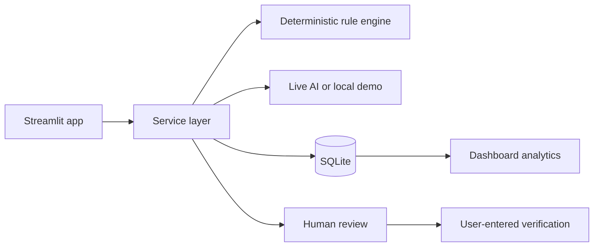

# Architecture

Packet Tracer is outside the application boundary. The user copies observed symptoms and `show` output into NetSage, reviews the evidence-backed recommendation, applies any approved change manually, and enters the before/after test result. No Cisco command is executed by the app.
